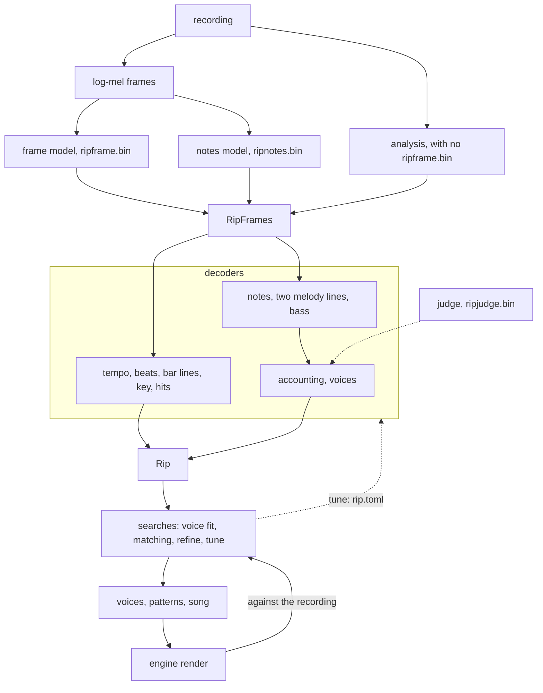

# Rip design

Decision record and working design for the rip: the engine's estimate of a
recording in its own vocabulary, voices, patterns, a key and a tempo, that a
player can edit and the sequencer can play. [Audio library
§9](https://github.com/lixenwraith/audio/blob/main/doc/audio.md#9-ripping-a-recording) describes what runs today;
this document is where it is going and why.

## 1. Purpose

A recording comes in; what comes out is what stapes could have authored: the
tonal voices the notes were played with, the drum hits and the notes as patterns
on the sixteenth grid, the key, the chord each bar leans on, and the tempo. The
engine is the ground truth of its own vocabulary, so a rip is good when the engine
playing its output sounds like the recording, and that is the loop everything
below closes.

## 2. Stages

Stages 1 to 3, and the renders, distances and grouping the later stages call,
are the audio library's ([library §9](https://github.com/lixenwraith/audio/blob/main/doc/audio.md#9-ripping-a-recording));
stapes loads the rip's models from its root, runs the searches and drives the
stream.

1. **Features.** `MelFrames` makes the log-mel frames the models hear, on the
   rip's own grid: 22.05 kHz, 93 ms windows every 11.6 ms, 229 bands from 30 Hz
   up, under a semitone apart from A3. The frame model reads each band in dB
   over a floor 80 dB down less the frame's mean, and the mean, so a phrase 20
   dB softer reaches it as clearly, and from a file of two channels each band's
   PCEN too; the notes model reads both planes as a harmonic stack, each
   harmonic a channel shifted onto its pitch's bin. `corpus` writes the frames
   in Go and the trainer reads them as audio does (`ripmodels.features`), so
   the models hear in stapes what they heard in the trainer.
2. **Front end** (`RipFrontEnd`). It hears a recording into `RipFrames`, the
   seam: per frame the strength of any onset and of each drum's, each pitch's
   salience, each register's chroma, and the models' planes below. The decoders
   read the frames alone, so none knows which front end heard, and the frames
   say which pitches they hold (`RipFrames.Range`): the analysis's E1 to C7, or
   those a weight file states, the piano's A0 to C8 for one built now and E1
   to C7 where it states none ([library
   §9](https://github.com/lixenwraith/audio/blob/main/doc/audio.md#9-ripping-a-recording)).
   The rip's three models are files in stapes' root:
   - the frame model, `ripframe.bin` (`ripmodels.FrameSpec`, §3): a
     transformer over the mel frames, its heads the onsets, the drums, the wave
     and voice genes a frame, the family of the highest note
     (`RipFrames.Family`, which no decoder reads yet), and whether a beat and a
     bar line fall on the frame (`Beat`, `Downbeat`); alone, each pitch's
     salience, strike, release and velocity too;
   - the notes model, `ripnotes.bin` (`ripmodels.NotesSpec`, the trainer's
     PitchNet), read only beside a frame model: a cell net over the harmonic
     stack, the same weights at every pitch, its heads each pitch's salience,
     strike, release, velocity and cents (`Cents`, `CentsError`) and what plays
     it, a family, a wave and genes kept at each frame's twelve most salient
     pitches (`VoiceAt`, `Voices`);
   - the judge, `ripjudge.bin` (`audio.LoadRipJudge`): a small network a stage
     over a strike's row, ruling which strikes are notes in the installed
     scores' place, loaded only beside a frame model and refused beside notes
     weights it was not fitted on.

   With no `ripframe.bin`, or where the models fail to load, the built-in
   analysis listens: a harmonic and a percussive part split by medians, each
   drum's onsets from its band, each pitch's salience from its partials, and
   no strike, voice, beat or bar line.
3. **Decoders**, over the frames alone:
   - **The grid.** The tempo by autocorrelation under a prior, the beats by
     dynamic programming over the onsets, the bar lines by a path over the
     pulses scored on the cues (the kick, the snare on the backbeats, the key's
     root in the bass, the chroma's change), the meter a choice among readings
     of the pulses, a pickup bar where sound leads into the first. Where the
     frames carry the beat and the downbeat head, they are read by their level
     as a plain tracker reads them: the tempo is how the beat head repeats,
     under the same prior, and the beats are tracked on it; a line falls every
     bar's beats from the place where the downbeat head, summed over the whole
     clip, stands highest over its mean beat, weighed beside the cues, which
     decide where its margin is small, the head never read at a beat on the
     clip's last frames. The meter is chosen by the cues' margins, with two
     rules of the heads' own: six beats are read against four only where the
     head stands at their lines over four's, as a head that marks the half bar
     marks both alike, and no reading is told by how it repeats under six bars.
     The pickup stays the decoders' own, and a clip the heads give no reading
     of is the cues'. The
     key and each bar's chord come from the chroma, the hits from each drum's
     onsets, a drum the frame model is never sure of silent.
   - **The notes.** Where the front end hears each pitch struck, both
     registers' notes start where a strike peaks over `strike` (`strike_low`
     under E3), as hard as it was struck, and last while the pitch sounds or
     until it is let go, any number at once; a strike starts none where its
     pitch never sounds, where it is a stronger strike's partial, within
     `strike_gap` of the pitch's last, or under `strike_again` on a pitch still
     ringing, and the bass line's own path adds notes where no strike sounds.
     With the cents head a note's sound is followed frame by frame across
     cells (`glides`): two cells naming one frequency within the errors the
     head states are one sound, a step that lands cuts it, and a glide stays
     one note with its bend. Without strikes, as from the analysis, the notes
     are paths through the salience, the melody register as two lines at once
     and the bass up to A3.
   - **The lines.** The melody register's notes are parted into two by what a
     line keeps, its pitch from note to note, its notes' length and strength
     and no two at once (`streams`), the lead the line a rule names, the busier
     by default (`Ripper.Lead`); a note both registers hear goes to the line
     it continues.
   - **The accounting** (`account`, under strikes). Each note's harmonics are
     read off the frames and fitted together, one template a pitch and one
     activation a note, its first partials remembered through its start, so a
     note the others explain goes and a strike the rules dropped comes back
     where its sound is its own: by the installed scores, logistic ones set on
     graded recordings, or by a judge, a reported note staying and a strike
     over a half that started none coming back where its odds reach a half,
     as a note that runs to its release as the decoder's own do, or not at all
     where its pitch does not sound. With no judge the rip is the installed
     scores', byte for byte.
   - **The voices.** Each note is told its voice (`tell`) from what the notes
     model says plays its pitch over the frames it sounds, a wave, genes and a
     family where its share passes the measure the weight file carries, and a
     line's voice is its notes' mean by length. Without those heads a
     register's voice is the frame model's genes over its notes, one over the
     melody's two lines; the analysis hears none.
   - **The thresholds** (`RipParams`) are the root's `rip.toml` or the built-in
     set, and `tune` searches them: all (`RipGeneRanges`) through the analysis,
     scored by `CompareRips` against what rendered loops should rip to
     (`ExpectedRip`), or, `tune ... truth`, the strike and path thresholds
     (`modelGenes`) through the loaded models and judge, scored by the mean
     over a truth list's conditions of the F1 by pitch and onset (`MatchNotes`:
     a note pairs one of its pitch within 0.1 s of its place, under a time map
     that holds a steady tempo or, `timed`, as given, the most pairs there
     are), a set that takes more than its guard from any condition refused.
     Where a truth gives drum hits a condition carries its drums' F1 beside
     its notes', a hit heard where a truth knows no drum plays counted
     against it (by the list's own hits a minute where a condition gives
     none), and `onset_min` is searched; where a corpus label gives bars,
     its bars (the downbeats given on a bar line, `MatchBars`), and the
     tempo's prior and combs, `tightness`, the bar lines' weights and the
     meter's margins are searched, which audio holds as parameters. The mean
     is over every score carried, the guard on each, and a parameter no score
     saw move is written as it stood. A set that beats the current one goes
     to `rip.toml`.
4. **Voices.** `rip` fits each line's voice to the recording, and `fit` again
   at the generations asked: its thirty-two genes and wave, seeded with the
   voice the front end heard and every registered one, scored by the mel
   distance between the recording around the line's longest and loudest notes
   and the candidate playing them at their pitch, loudness and length at the
   recording's tuning (`RenderNoteAt`, `MelDistance`, `fitDistance`), its level
   set after to the recording's there. The melody's second line gets one of its
   own (`Rip.UnderVoice`). The recording around a note holds the other voices
   too, so the fit is to the mix there: the models propose, the engine
   disposes.
5. **Patterns and the dictionary.** Notes and hits fall into bars on the
   sixteenth grid. `rip` writes windows of up to four bars as patterns, the
   estimate heard first; `compress` writes the dictionary, per part (beat,
   melody, bass) the bars that stand for the others, each a one-bar pattern
   (`<name>_<part>_a`, `_b`, ...), and the song, which bar plays which at the
   recording's tempo, key and tuning, on drums matched to its own (`SongDef`, a
   `[[song]]` in the pattern document; `Rip.Kit`). A bar is matched to a member
   by `BarDistance`, the steps two bars do not share over the steps either
   has, a hit by drum and step and a note by step and pitch, its accidental
   included.
6. **Compression.** Bars within a threshold of one another merge into one
   member: 5% of their steps in the notes, 40% in the beat, where a rip's
   errors are scattered hits and a drummer's change is many at once. The
   mechanical pass runs first (`Cluster`: each bar its own group, the two
   nearest merged by their mean distance while it holds within the threshold,
   the medoid standing for each), then a search over the assignment
   (`refineAssignment`): each bar's member, seeded with the mechanical answer
   and taken only when better, scored by the members in use, heavily by a bar
   farther from its own than the threshold and lightly by the mean distance.
   It rarely beats the mechanical pass under this distance, and is there for
   a distance by reconstruction.
7. **The loop.** `compress` renders the song (`AudioEngine.RenderBars`, at its
   tuning on its kit) and rips the render back with its tempo, its downbeat at
   the start and its meter pinned (`songRipper`), so the score is of the hits
   and the notes, not of the tempo and bar-line decoders: that rip against the
   recording's (`CompareRips`) is how much of the rip survives as the song,
   drums, melody and bass apart. `refine` then moves the voices and the steps
   in turn, judged by `Fidelity`, since a rip-back cannot see the rip's own
   mistakes: the render and the recording heard through one front end
   (`Ripper.Sound`), their pitch salience, mel bands and onset strength
   compared bar by bar on each one's own beats. Each line's voice is searched,
   seeded with the voice in hand and every registered one and held within a
   tenth of its distance from the recording's notes as the fit measures it
   (`refineDrift`); each step is swept through a semitone and an octave either
   way, the recording's strongest pitch there, a step either way, longer,
   shorter and silent, judged on the bars that play its pattern
   (`songJudgeBars`), and an empty step tries that pitch, the way in for a note
   the rip missed. Rounds of both run until one gains under 0.005.

The voice fit, the matching, `refine`'s voices and `tune` run on
`lixenwraith/genetic` (§6 lists what it gave them); `refine`'s steps are swept.

**The stream** (`RipStream`) follows a recording as it plays: blocks of samples
go in and the front end's ear hears each frame once. The models' ear
(`FrontEnd.Ear`) runs each frame through each model once (`transformer`'s
`Stream`) and gives the frames in half-second steps once those a model reads
after them are in, the frame model's reach, 2.97 s, or `FrontEnd.Ahead` where
shorter, never under the notes model's reach; the analysis's ear gives them a
third of a second behind the sound. Once the beats tracked fill six bars of
4/4, the first bars are decoded as offline and their tempo, meter and key held;
each later bar is decoded on from the last frozen line and freezes once two
follow it (`Bars`). `Close` freezes the rest and adds the voices and the drums'
tone; `Final` rips the whole recording offline. `live` drives a stream over a
file, takes its `Final` rip as `rip` takes one and measures the stream by it.

The output is a sound document of voices, a pattern document of patterns and the
song, which bar plays which at what tempo and in what key, the form the engine
lacked: stapes plays one through the live sequencer, each bar's patterns landing
on its bar line (`song <name> play`), and renders one offline (`song <name>
<file.wav>`).

## 3. Learning

- **Corpus.** The engine renders it (`corpus`): loops of the registered rhythm,
  melody and bass patterns, or arranged (`gen`, below), across tempos and
  keys, each with its WAV, its mel
  frames and its events in frames, with the wave and genes of the voice each note
  was played with. Labels cost nothing and are exact. What it lacks, in order of
  need: a mix, a room and a codec between the render and the frames (impulse
  convolution, noise, equalisation, a low-pass), voices beyond the shipped five
  (random genes), chance steps as optional targets, and real recordings with
  hand-checked notes held out for validation, so neither a model nor a tuned set
  learns the synthesizer. The generative lead is left out: the sequencer writes
  its notes bar by bar as it plays, so no label read off the pattern holds them.
  Every event carries the family it sounds as (`families` in the manifest):
  the engine's voices by one table, a voice redrawn far from every bank voice
  unknown, NSynth's instruments by name (`sampled`), and a recording's notes
  by its list's `family` cell or, without one, each note's MIDI program, every
  part of the file included (`corpus <dir> from`).
- **Augmentation.** `corpus ... aug` puts a room and a mix behind each loop,
  drawn per loop: a gain and a swell of up to 6 dB, for half the loops a
  one-pole low-pass at 4 to 11 kHz, two equaliser bands within 6 dB from 80 Hz
  to 8 kHz, for a third a soft clip (drive 1.5 to 3.5), the saturation a mix is
  thickened with, which piles harmonics on every note and sum and difference
  tones between notes, for half a compressor, a booth's Schroeder reverb or for
  a third a hall's, and for half a noise floor 40 to 65 dB down, a loop past
  full scale turned down rather than clipped. It redraws each tonal track's
  voice near the registered one, a third of the time on another wave, in a
  third of the loops with every release but the bass's three to ten times as
  long, a pedal's ringing, all labelled as played, and renders the loop off
  A440 by up to a quarter tone either way (`SetTuning`), since recordings are.
  Every loop, augmented or not, is laid at a level drawn between -32 and -14
  dBFS. `gen` arranges every loop in place of the bank's patterns, since the
  bank alone repeats its few melodies and a model trained on it learns them,
  not pitch: a key and a chord progression over the whole keyboard, a line
  alone or up to six parts (drums, a bass, a keyboard's two hands, a guitar's
  strokes, a pad, an arpeggio, a melody grown from its motif, its double, a
  counter-line), parts entering and dropping out, swung, syncopated, resting
  and breaking, and played as a player would, accented, swelling and fading,
  off the grid by a feel of its own, its tempo drifting. `meters` puts the
  loops in seven meters, three in ten starting part-way into a bar, and
  `overlaps` gives a quarter of them single notes of one to eight instruments
  in no meter ([Rip training §3](rip-training.md#arranged-loops) holds the
  rules and their figures). `codec` sends a third of the loops through Opus,
  MP3 or AAC and back. Some voices are driven hard, as a guitar through an amp.
  `glide` moves pitch as a singer or a string player does: a fifth of an
  arranged loop's melody, double, counter-line and bass notes bend into the
  note that follows at once, over their last 60 to 250 ms, a seventh scoop into
  their pitch from a semitone or two under, and three in ten of a loop's
  oscillator voices sway with a vibrato; every note that moves is labelled with
  its cents at each frame. Each word draws from streams of its own, so a loop
  it leaves alone is the same with it and without. The trainer changes a share
  of the windows as it draws them: `--channel` hears them through a small
  speaker, a room and a phone, and `--over` lays real drums under loops that
  have none, labelling a hit only where it can be heard ([Rip training
  §6](rip-training.md#6-what-may-change-a-windows-frames)).
- **Harness.** `tool/rip-train/pipeline.sh` runs the corpus, the training, the
  bench and the install with every knob an environment variable, the corpus in
  `PARTS` exports at once, each keeping the loops already on disk, and a focus
  script run before the corpus turns a run toward a kind of music (`focus/`:
  vocals as lines, plucked instruments); a training round spreads a run over
  several machines, shards from one start averaged into the next (`shard`,
  `merge`); `tool/rip-train/README.md` is the guide. A voice carries a vibrato and a vowel's formants for the vocal focus,
  neither a gene, kept by the augmentation when it draws voices near a
  registered one. The step exported is the best by `--validate`, a corpus of
  recordings none of the tests hold (GuitarSet's player 04: picking the step is
  a fit, and MusicNet's pieces only measure), a notes model's by its strikes' F1
  there, since the rendered loops' held-out loss need not predict recordings;
  `--family-holdout` leaves a family out for the run that sets unknown's bar;
  and `tune ... truth <list>` searches the decoders' thresholds against real
  recordings' truths through the loaded model, each heard once, writing the
  `rip.toml` that ships beside the weights.
- **The frame model** ([library §9](https://github.com/lixenwraith/audio/blob/main/doc/audio.md#9-ripping-a-recording)). `ripmodels.FrameSpec`: 230 inputs
  (229 bands and the level), width 256, eight heads of 32, four layers,
  feed-forward 1024, a window of 64 frames either side, 3.3 million weights
  (13.2 MB); its heads are §2's, of three drums, its pitches (the
  piano's eighty-eight, sixty-nine in a file of E1 to C7), five waves,
  thirty-two genes and nine families. Attention carries ALiBi biases, a
  slope per head on the frame distance, so it has no positions to learn and
  generalises past the training window. A file may put convolutions over
  frames and bands before the input layer, each pooled over the bands
  (`transformer.Conv`), split the layers into towers over the shared input
  layer, each computing a run of the heads (`transformer.Tower`), so the drums
  need not share the pitch's layers, and read a second channel
  (`transformer.Config.Channels`): each band's PCEN and their mean, in which
  what a room or a microphone holds steady fades and a strike stands out at
  any level. `tool/rip-train` is its PyTorch twin and writes the weight file
  `lixenwraith/transformer` loads
  ([format](https://github.com/lixenwraith/transformer/blob/main/doc/format.md));
  the instructions are its README, and [Rip training](rip-training.md) follows
  the data byte by byte from a loop's frames to the weight file.
- **Inference** is pure Go, float32, no CGO, the same on every host to float32
  rounding. A three-minute song is 15500 frames, 26 GFLOP a layer at the
  default width, and the width and depth are the file's to choose.

## 4. Layout

- `lixenwraith/audio`: the rip, its parameters, the decoders, the built-in
  analysis, the features, the truth (`ExpectedRip`, `ExpectedEvents`) and the
  score (`CompareRips`), the offline renders (`RenderMusic`, `RenderTimeline`,
  `RenderNote`), the distances (`MelDistance`, `BarDistance`), the mechanical
  clustering (`Cluster`), the song (`SongDef`), a step's glide (`bend`), the
  bar phase against a score's or an annotation's downbeats (`MatchBars`,
  `ReadJAMSBeats`), `ReadMIDI` with every part's notes and programs, and the
  rip that follows a recording as it plays (`RipStream`). Imports only `toml`.
  The searches stay out of it, so it stands alone, a module of its own.
- `lixenwraith/audio/ripmodels`: the learned front end, `FrameSpec`, `NotesSpec`
  and `Hear`. Imports `audio` and `transformer`.
- `lixenwraith/transformer`: inference over frames and the weight file, a
  module of its own. Standard library only.
- `lixenwraith/genetic`: the searches, over `RipParams`, over voice genes and
  over bar-to-pattern assignments, with seeds, a schedule, a checkpoint, a
  cache and a categorical operator for them. Standard library only.
- `lixenwraith/stapes`, this module: the verbs that drive it all (`rip`, `fit`,
  `compress`, `song`, `render`, `corpus`, `tune`, `truth` with its bars and
  every-part rows), the documents the results land in, and the files overlay
  (`^O`) that loads, rips and saves them. `live` drives the live rip over a
  file; its host to come is vif's Android app, which takes `RipStream` from
  the library (vif's todo).
- `tool/rip-train`: the trainer, Python, beside the Go module.

## 5. Budgets and determinism

The analysis runs about forty-five times real time on one desktop core, the models
add seconds per minute of audio at the default width, and memory is a few floats
per frame per pitch: tens of megabytes for a song. Every render and draw is
seeded, the searches run on fixed streams, and the models are float32 arithmetic in
a fixed order, so a rip of one recording with one weight file and one parameter
set is the same rip on every host.

## 6. What `lixenwraith/genetic` gave the searches

The voice fit and the dictionary matching asked for what the parameter search
did not, and the generational engine now has it:

- assignment genomes: a `[]int` of each bar's representative under
  `CategoricalPerturbator`, which moves an element to another of its categories,
  and `UniformCombiner` over ints; a move, a swap, a split and a merge are all
  reachable by it, and the size term in the score does the merging, so the
  dedicated operators waited and were not missed;
- the fitness with a size term and a constraint is a scalarization in stapes'
  `compress`, not a `fitness` bundle: three terms, one line, and a search that
  changes its distance changes that line;
- an adaptive step: `SetSchedule` with `AdaptiveStrength`, the one-fifth rule,
  so the voice fit widens its step while it improves and narrows while it stalls;
- evaluation caching: `Memoize` wraps an evaluator with a cache by genome key,
  safe under parallel scoring, so a render is paid once per candidate;
- a checkpoint for the batch engine: `Checkpoint` and `Restore` carry the pool,
  the history, the knobs in force and the random stream's position, and a
  restored run ends where an unbroken one ends;
- seeding from several candidates: `SetSeeds` opens the first generation with
  them, every registered voice for the fit, the mechanical grouping for the
  matching.

What it does not have and may yet need: a covariance step (CMA-ES) if the voice
fit stalls on correlated genes once its distance is a model's, and a
reconstruction-scored matching that renders per candidate, where `Memoize`
and the checkpoint earn their keep.

## 7. Plan

1. Done: the analysis and the decoders; parameters as data and their search;
   the offline render, the truth and the score; the transformer, `ripmodels`,
   the corpus, the trainer and training in rounds across machines; the voice
   fit by analysis-by-synthesis; the dictionary, matching and compression; the
   song document, rendered offline, a line at a time, and conducted live; the
   augmented, detuned, saturated corpus with generated parts, a lead over an
   arpeggio; `bench`, loop by loop; the refinement loop judged by `Fidelity`
   with the voices held to the fit; the recording's tuning, a pickup bar, the
   notes' lag, accidentals; the two melody lines decoded together and parted
   by their character under a lead rule; the bass decoded to A3; a note's
   brightness; and the truths: transcripts corrected by hand, rhythms tapped
   out, MIDI files, and two rips of one piece as witnesses.
2. Landed: the bar line's cue that counts the silence before a recording; the
   bar phase scored against a score's or a JAMS annotation's downbeats
   (`MatchBars`, `truth`'s bars row); a step's
   `bend`, played by every voice and written and read as MIDI pitch bend; the
   family of every corpus event and the frame model's family head with
   `--family-holdout`; every part of a recording's MIDI in its labels and its
   truth, each note with its program; `--validate` and the validation corpus;
   `tune ... truth`; and `RipStream`, bars frozen two behind the sound from the
   sixth bar on, `Final` the whole rip afterwards.
3. Landed: `--validate` picks a notes model's step by its strikes' F1 at the
   decoder's bars; `rip` fits every line's voice, the voice a model heard its
   first seed; and `corpus` takes every word its usage names. `gen` arranges
   every loop over the 88 keys with a real arrangement's textures, in seven
   meters with `meters`, beside single notes in none with `overlaps`.
4. Next. Five rules hold for all of it:
   - A number that picks anything counts a note right by its pitch and onset,
     whatever line holds it.
   - No constant is turned by hand until a set scores well. It is fitted from
     data by a stated procedure and checked on a condition left out of the
     fit, or it is read from the recording itself, which the rip may loop
     over: live the bars behind it, and the whole once it has ended.
   - A line is a voice heard, as many as the recording holds and for as long
     as each plays, never a register or a count assumed; and a voice is genes
     the engine plays, with a family's name only where one is sure.
   - What is decided of a part of a song, its tempo, meter and key, its
     voices, holds within that part and is never carried across a boundary
     into a part it has nothing to do with.
   - Nothing is trained or fitted on a set whose licence is non-commercial or
     research-only (MAESTRO, MAPS), on a song's recording, bought or not, or
     anything taken from one, or on a commercial song's transcription. Such a
     song measures the rip on real-world music and no more, since no licence
     covers training on it; a corpus or a fit takes the engine's generated
     parts and mixes, public-domain scores it renders and the CC BY sets whose
     recordings were made for them of music original to them, improvised or in
     the public domain: E-GMD, VocalSet, NSynth and GuitarSet train, and
     MusicNet and vocadito only measure ([credits](../CREDITS.md)). A round's
     notes name every collection it took, for the credits.
   Code alone, a thread each, in parallel:
   - **Notes by pitch and onset, and the search under a guard**, landed.
     `Agreement` counts every note as one line (`All`) and `MatchNotes`
     matches a truth on the recording's own clock without a map (`timed`);
     `truth` leads with that row; `tune ... truth` scores by it as the mean
     over the conditions its list names, refuses a set that costs any
     condition more than its guard, keeps the frames it heard (`frames
     <dir>`) and starts its pool at the thresholds it is improving. The
     validation list wants its conditions first
     ([todo](todo.md#tune-the-rip)). Nothing it writes is installed before
     every condition has decoded under it.
   - **Glides.** Landed: the corpus labels a moving note's cents at every
     frame and `glide` bends, scoops and sways arranged notes; a cents head
     on the notes model gives each pitch's offset and the error it states for
     it; the decoder joins two cells where they name one frequency within
     those errors and keeps a step that lands.
   - **The stream read from outside, and `live`.** Landed: `RipStream` gives
     the frames heard since a frame with the spectrum they were read from
     (`Frames`) and its open bars as last laid out (`Open`); `live` drives it
     over a file and measures it against the offline rip.
   - **Each frame once.** Landed: a stream in `transformer` runs each frame
     through each layer once and gives the pass over the whole when it waits
     a model's reach, which the ear does (2.97 s for the frame model), and
     the GELU runs over a row in the kernels. Waiting half a second instead
     leaves the pitched heads as they are and moves the frame model's, so the
     reach is the default.
   - **The beat and the bar line heard.** A guitar alone has no kick, no snare
     and no bass for the cues' rules to read its bars by. Landed: a beat and a
     downbeat head on the frame model, read as §2 says, and their trainer: a
     rendered loop's targets from its own grid, a recording's from its list's
     `beats` column, a loss with no weight on a beat, and each head's F1 on the
     lines ([Rip training §5](rip-training.md#5-the-targets) and
     [§8](rip-training.md#8-a-training-step)). No file is installed on its
     heads' word before they read more bars right than its cues
     ([todo](todo.md#teach-the-frame-model-the-beat-and-the-bar-line)).
   Then, each waiting on recordings, on a thread above or on a design agreed:
   - **The voice of every note.** Heard per pitch cell on the notes model, not
     per frame: a family, a wave and the genes of what plays that pitch,
     taught on the engine's own voices and on real notes the fit has labelled,
     so a note of an instrument with no name still has a voice the engine
     plays. `unknown` is no class: a note has no name where no family's
     posterior reaches what a family held out of training reaches. The frame
     model keeps the drums, the onsets and the beat, and is judged by what its
     raw planes add to a note's voice: its attack, its noise, the room.
     Landed: the three heads a cell, taught where one note alone sounds in
     it; `--family-holdout` a note, whose reach the weight file carries as
     the measure; audio's reading of them at each frame's twelve most salient
     pitches into every note's voice, and a line's voice as its notes' mean
     ([Rip training §5 to §10](rip-training.md#5-the-targets)). Not yet: real
     notes the fit has labelled, the frame model's planes as context, and a
     round at the notes model's own length
     ([todo](todo.md#the-instrument-model)).
   - **Lines by voice.** Notes gather into lines by their voices and their
     continuity, a line opening when a voice enters and closing when it
     stops: first inside the three lines a rip holds today, then the rip, the
     song and the game with as many as were heard. A song's interleaved
     lines, a solo cello filed on two and a guitar's notes on a bass line wait
     on it.
   - **The judge.** A small trained stage whose reach is its fit's breadth:
     fitted on the notes model in use, from the CC BY collections with truths
     that train, renders and the engine's mixes; refitted after each round,
     reading the note's voice once notes carry one; and installed only when no
     collection left out of the fit scores under the installed rip by more
     than its spread, singing apart, which is reported and holds no stage
     back. A recording is judged in one pass. The decoder then says what it
     kept and dropped, the live view's last read. The stage stands since audio
     v0.22.0 and stapes v0.19.0, with no fit installed: the row and the
     judge's file (library §9), `rows`, `judge.py` and the root's
     `ripjudge.bin` ([a judge](../tool/rip-train/README.md#a-judge)).
   - **Sections.** A recording is read in parts, a boundary where tempo,
     density, level or harmony change by more than they vary inside a part;
     tempo, meter, phase and key are decided a part at a time, in the stream
     again at every bar until two decisions agree, the bars after the last
     agreed one provisional.
   - **The live rip in the hands.** stapes in vif's Android app over the
     microphone, the stack shown as it works: the spectrum, the planes the
     models are given, the heads, the judge's verdicts, the grid, and the
     bars in a compact lane that a line or a part filters.
   Put off: a second piece of music under the first, which wants the judge to
   follow instruments as it follows notes; and a phone's bass, where the bar
   is not the lever.
   How a round is judged: each set by pitch and onset against its own spread,
   a pair sharing all but the one change; the bars row; the strikes' F1 on a
   validation corpus with a condition a kind; vocadito's fragments, wrong cells and repeats with the
   legato steps kept; each family's recall on NSynth's held-out instruments
   and the rip's voice over the fit's distance there; a song's bass and
   kicks, clean and through a phone; and `bench`.
   Dropped by measurement: padding or mirroring a recording's edges (the
   strike head at a loop's first frame scores as mid-song; silence before it
   and the mirror both cost); more width; soups of rounds; rounds of one
   recipe plus one augmentation judged by the mean; a step picked by the
   validation loss, most of which is a head Go never reads; a `rip.toml`
   tuned on one instrument; `strike_again` or `strike_low` moved by hand for
   a set, each measured to trade one set for another; a recording's
   thresholds searched against `Fidelity`, which puts no price on a wrong
   note and so ranks a recording's decodes at chance against their truth;
   the accounting's logistics refitted on more recordings; and a second pass
   over a recording, its evidence read against its own notes, its fit bent
   to its sure verdicts or its bar set by its own odds, each trading one
   family for another.
5. Then: the weights shipped as data with the `rip.toml` they were judged
   under.

## 8. Decisions

- **The decoders stay classical.** Tempo, beats and note cutting are solved
  problems with cheap, inspectable solutions; a model earns its place at the
  perceptual front end, where hand-made features fail on real instruments.
- **Features are computed in Go for training too.** A second implementation of
  the mel frames would have to match bit for bit; the corpus carries the frames
  Go made instead.
- **Relative positions by ALiBi, windows by a band.** No learned positions, no
  limit from the training length, attention cost linear in the recording.
- **Voices as genes.** One vector serves the models' regression heads, the
  search's genome and the document, on the scales the ear hears.
- **The engine labels its own corpus.** Exact labels for free, with the
  synthesizer's domain as the cost to pay down with augmentation and held-out
  recordings.
- **The models are optional.** The analysis ships and works everywhere; a weight
  file in the root upgrades the hearing without a build.
- **Pure Go inference.** No CGO, no runtime to ship, the same path on the
  desktop, the browser and the phone.
- **The searches live in stapes.** `lixenwraith/audio` holds the primitives,
  a render, a distance, a mechanical grouping, and `lixenwraith/genetic` the
  engine; stapes joins them, so `audio` is a module of its own without
  `genetic`.
- **The song is a document.** `[[song]]` beside the patterns, names not ids, a
  tempo and a key of its own, so a ripped song is edited, saved and played like
  anything else authored, and the conductor's tiers stay the game's.
- **The score is the rip of the render.** A song is as good as the rip it rips
  back to; the same `CompareRips` grades a parameter set, a model and a
  compression, so their numbers compare.
- **The render is heard against the recording itself.** The rip-back is blind
  to the rip's own errors, so a search on it polishes a wrong transcript;
  `refine` judges a render by `Fidelity`, its frames against the recording's
  through one front end, so a wrong note costs what the ear hears, and the
  rip-back stays the number that compares across passes.
- **Accidentals, not a chromatic scale.** A step keeps its degree in the key
  and carries the semitones left as `acc`, so the harmony, the chord following
  and the editor's rows keep their meaning while a transcript loses no note.
- **The front end reads the tuning.** A440 is an assumption a recording need
  not share: forty cents off puts every pitch between two salience rows, and
  no decoder downstream can repair the wobble that makes.
  And the engine renders at it: a song played at A440 beside a recording forty
  cents flat sounds sharpened, a stretched string, before any note is judged.
- **Two lines are one decoder, not the louder and the rest.** The louder
  pitch of each frame is not a line: a lead and a counter line a few notes
  apart trade places wherever one is momentarily louder, and a second pass
  over what the first left finds fragments, and concurrent notes assigned by
  pitch order hold only while the lead stays the upper.
  Decoded together, each line keeps its own continuity, and which is the lead
  is a cost, not a rule: the first line pays a little each frame to be the
  quieter, so it follows the louder line through a crossing and gives it up
  only over a rest or an inversion that lasts. A stream assignment after the
  fact, by pitch, timbre and level over the notes two passes of one line had
  cut, cannot mend them: those notes are already cut wrong.
- **The lead is a line's character, named by a rule.** Decoded together, the
  two lines are continuous, but the decoder's first line is the louder, and
  the lead a listener hears may be the softer: a steady line of short notes
  under a counter line of held notes. So the notes are
  parted again by what each line keeps, pitch, length, strength and no two at
  once, which the decoder's loudness tie-break cannot see, and which line is
  the melody is a rule the listener can set, the busier by default, since no
  one cue holds for all music, neither loudness nor pitch order. A note's
  strength is weighed against the register's reference, not raw: raw, it
  outweighs every other cue and the parting follows loudness alone.
- **What plays is said a pitch, and named only where a name is sure.** A head
  a frame names one note of it, the highest, so the bass is seldom asked and
  a line under the melody never; and `unknown` taught as a class takes every
  engine voice far from the bank. A
  head a pitch says what plays each note, a line under another as the one
  over it, and a voice of genes is what every note gets, a name being extra:
  given where its share over the note passes what the notes of a family the
  notes model was told no name of reach, a number a run reads off held-out
  notes and no hand sets. `unknown` is then what is left, the absence of a name.
- **Ground truth is a transcript corrected by hand; two rips are two
  witnesses.** The numbers so far grade the mix, not the melody; what the
  user hears as the lead has no number. `truth` scores a rip against notes
  given in the `notes` verb's own text, which a listener corrects by hand, by
  a time map from the longest common subsequence of the pitches in time order
  under the transposition that matches most, a note right within 0.1 s of its
  place, so a tempo that drifts or a phrase played freer, a live take against
  a studio one, does not break the match and a note far off does not count;
  `agree` holds two rips of one piece to each other the same way where no
  score is to hand, by line and with the melody register as one, since the
  two may part its lines differently.
- **A rhythm tapped out is a truth.** A listener can write a piece's
  structure down by ear, the lead's note lengths and that the second line
  runs in eighths, but not the pitches of a fast line under others. A truth
  without pitches, `unit eighth` and `(1-2-3---4-56---)x3 a-a-a-a-a-a-a`,
  is matched by when its notes start, and it answers the questions the
  renders left open: which line is the lead, how many of its notes the rip
  cuts or merges, and how far the lead rule's default is from the ear. It is
  the number to chase while the pitches stay the ear's.
- **A refined voice stays near the fit.** The song's score is of the whole
  mix, and a bright voice fills a mix better than the voice that sounds like
  the line, so `refine` drifted every voice toward a driven saw while the
  number rose: the renders sounded electronic where the fit's had sounded like
  the recording. Each voice now has a tonal floor, its distance from the
  recording's notes as the fit measures it, and the search hears no candidate
  past the floor by more than a tenth; the score picks among voices that sound
  like the notes. The sweep's proposals keep within a fifth of their track's
  nearest note for the same reason: a pitch the mix is strongest at is not
  thereby the line's.
